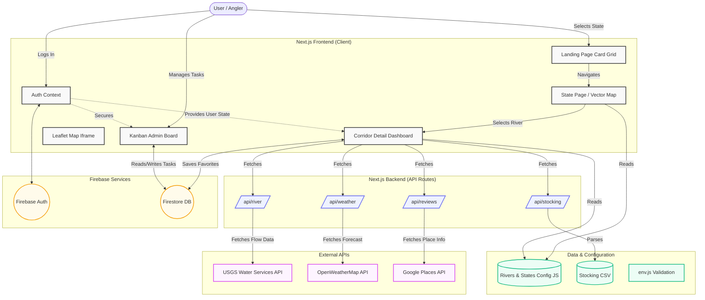

# Architecture Overview

This document outlines the high-level architecture of the Fly Fishing Trip Planner. 

## System Context Diagram

The application is built using Next.js (App Router) and uses Firebase for authentication and database services. It aggregates data from several external APIs.

## Component Details

### 1. Frontend (Next.js App Router)
- **Landing Page (`src/app/page.js`)**: A home view displaying state selection cards for Ohio, Michigan, Pennsylvania, West Virginia, Tennessee, North Carolina, and Montana.
- **State Overview (`src/app/states/[stateId]/page.js`)**: Displays the interactive SVG map (`StateVectorMap.js`) and the state's river corridors list.
- **Corridor Dashboard (`src/app/states/[stateId]/corridors/[corridorId]/page.js`)**: Renders details for a single corridor (`CorridorDetails.js`), aggregating river gauges, weather, local reports, and access maps.
- **Context API (`AuthContext`)**: Handles authentication state using Firebase Auth and syncs favorite rivers to Firestore.
- **Admin Kanban**: A private route accessible only to users with the `isAdmin` flag in Firestore, allowing task tracking.
- **Maps**: Embeds a Leaflet map via an iframe or native React wrapper, communicating via `postMessage`.

### 2. Backend (Next.js Route Handlers)
To avoid CORS issues and secure API keys, all external data fetches happen server-side:
- `/api/river`: Proxies requests to the **USGS Water Services API** for streamflow (cfs) and gage height.
- `/api/weather`: Proxies requests to **OpenWeatherMap** (or returns mock data if keys are missing).
- `/api/reviews`: Proxies requests to **Google Places API** for star ratings and reviews.
- `/api/stocking`: Parses the local `stocking_history.csv` to return ODNR fish stocking history.

### 3. Config & State Management
- `src/config/env.js`: Uses Zod to parse and validate environment variables (Firebase config, API keys) early to prevent runtime crashes.
- `src/config/rivers.js`: A static configuration tree grouping river corridors dynamically under hierarchical state parameters.

## Architecture Decisions & Plans

Architectural decision records and proposed architectural changes are stored in the `/docs/` directory for full SDLC2 compliance:

### Architectural Decision Records (ADRs)
- [ADR 0001: Next.js App Router Architecture](file:///Users/jonathonkline/Library/CloudStorage/OneDrive-Personal/KLINE/Jon/Fly%20Fishing%20Trip%20Planner/docs/ADR/0001-nextjs-app-router-architecture.md)
- [ADR 0002: Firebase Authentication & Firestore Persistence](file:///Users/jonathonkline/Library/CloudStorage/OneDrive-Personal/KLINE/Jon/Fly%20Fishing%20Trip%20Planner/docs/ADR/0002-firebase-auth-and-firestore-integration.md)
- [ADR 0003: External API Proxying & Caching](file:///Users/jonathonkline/Library/CloudStorage/OneDrive-Personal/KLINE/Jon/Fly%20Fishing%20Trip%20Planner/docs/ADR/0003-external-api-proxying-and-caching.md)

### Implementation Plans
- [Weather API Redundancy Plan](file:///Users/jonathonkline/Library/CloudStorage/OneDrive-Personal/KLINE/Jon/Fly%20Fishing%20Trip%20Planner/docs/plans/weather_api_redundancy_plan.md)
- [SDLC2 Audit & Remediation Plan](file:///Users/jonathonkline/.gemini/antigravity/brain/16cfac60-4b88-451f-9032-a1340f15f991/implementation_plan.md)

### Code Cleanup Log
- **Removed Legacy `Dashboard.js`**: Deleted 51 KB legacy monolithic dashboard component to eliminate architectural bloat after state-based App Router refactoring.

