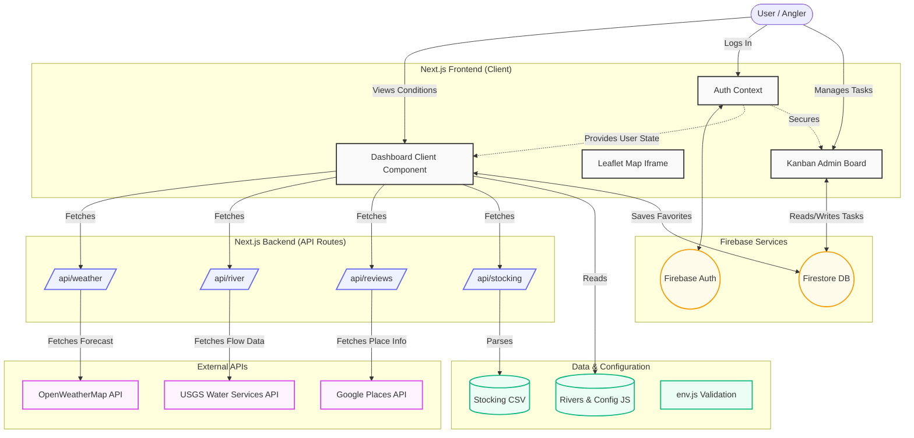

# Architecture Overview

This document outlines the high-level architecture of the Fly Fishing Trip Planner. 

## System Context Diagram

The application is built using Next.js (App Router) and uses Firebase for authentication and database services. It aggregates data from several external APIs.

## Component Details

### 1. Frontend (Next.js App Router)
- **Dashboard Component**: The core view aggregating all the data. Contains sub-panels for stream flow progress bars, weather forecasts, angler reports, and maps.
- **Context API (`AuthContext`)**: Handles authentication state using Firebase Auth and syncs favorite rivers to Firestore.
- **Admin Kanban**: A private route accessible only to users with the `isAdmin` flag in Firestore, allowing task tracking.
- **Maps**: Embeds a Leaflet map via an iframe or native React wrapper, communicating via `postMessage`.

### 2. Backend (Next.js Route Handlers)
To avoid CORS issues and secure API keys, all external data fetches happen server-side:
- `/api/river`: Proxies requests to the **USGS Water Services API** for streamflow (cfs) and gage height.
- `/api/weather`: Proxies requests to **OpenWeatherMap** (or returns mock data if keys are missing).
- `/api/reviews`: Proxies requests to **Google Places API** for star ratings and reviews.
- `/api/stocking`: Parses the local `stocking_history.csv` to return ODNR fish stocking history.

### 3. Config & State Management
- `src/config/env.js`: Uses Zod to parse and validate environment variables (Firebase config, API keys) early to prevent runtime crashes.
- `src/config/rivers.js`: A static array containing the master list of rivers, flow ranges, species, and access points.
