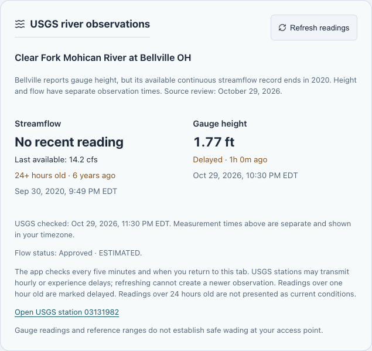
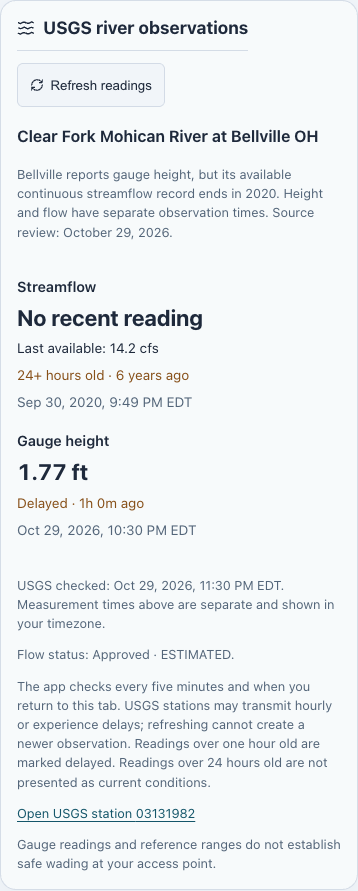

# Gauge freshness verification — October 29, 2026

- `npm test -- --runInBand`: 65 tests across 13 suites passed.
- `npm run lint`: passed.
- `npm run build`: passed, Next.js 16.4.3 production build.
- Real upstream through the local production server: Yellow Breeches returned HTTP 200 with `Cache-Control: no-store`, flow 120 cfs and height 1.17 ft measured at 2026-10-30 00:45 UTC, checked at 01:10 UTC. The check time did not replace measurement times.
- Real Clear Fork observations: 2020 flow remains secondary historical context; independently dated height remains visible. During the later screenshot capture height was just over an hour old and correctly labeled delayed. The display does not promise that removing app caching makes all observations fresh.
- Browser fixture: delayed Yellow Breeches flow + recent height → manual refresh receives 502 → original values and measurement/check times retained → second manual refresh succeeds and clears the error. Three requests observed.
- Au Sable and South Holston: visible historical/unconfigured notices, no Refresh button and no river API requests. South Holston links TVA and has no null-ID station link.
- Browser layout checked at 1365px and 390px without horizontal overflow. The narrow screenshot uses a taller viewport to capture the entire panel; a 390×844 viewport was also checked. Final screenshots were visually inspected. Links and secondary timestamps use darker colors than the previous panel.
- Design detector reported no deterministic issues for the edited stylesheet. No ignores/suppressions added.

The local fixture checks do not change production data. Firebase rules and account behavior are unchanged; the repository CI continues to run its Firestore emulator suite. See the [dated gauge audit](../data/gauge-freshness.md) and [central regression conditions](../../TESTING.md).
