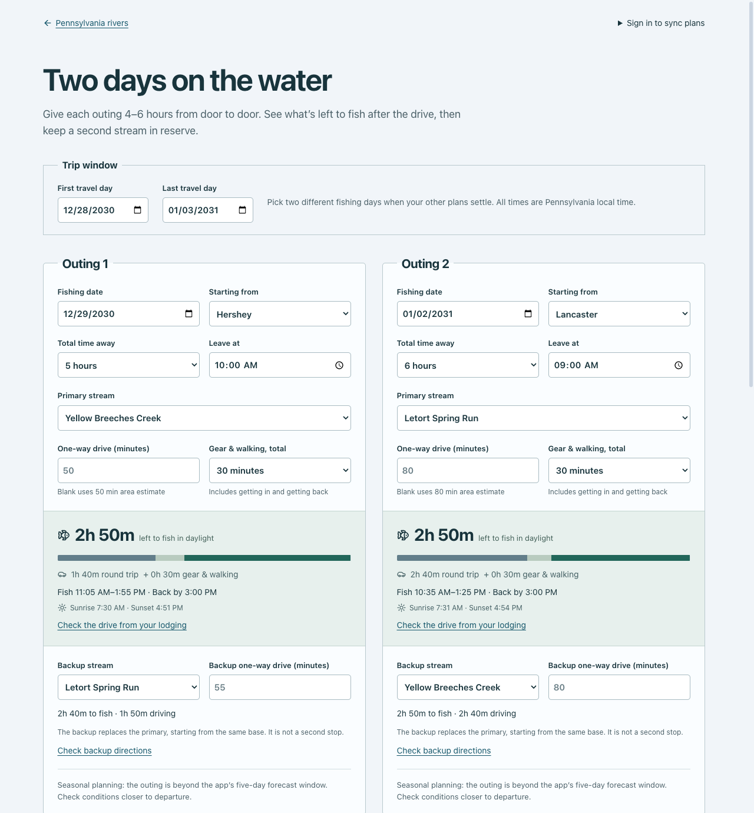
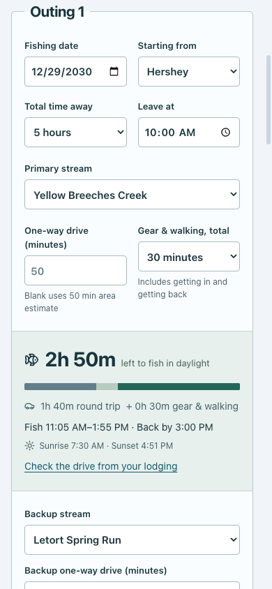

# Two-outing planner verification

Verified locally on 2026-10-29 against a production Next.js build. Screenshots use fictional dates, not personal travel plans.

## Automated results

- ESLint: pass.
- Jest: 55 tests across 11 suites, all passing. New cases exercise date and time budgets, daylight/DST, plan storage, editing, failures, and session changes.
- Firestore emulator: 11 tests, all passing. Existing favorites protections and new owner-only plan rules run against the committed rules with the isolated demo project.
- Production build: pass; `/plan` and `/planning-sources` prerender successfully.
- `npm audit --omit=dev --audit-level=low`: zero production vulnerabilities.
- `git diff --check`: pass.

## Browser checks

- Desktop 1280px and phone 390px: no horizontal overflow. Phone time choices and backup names remain readable after narrowing the copy and stacking backup controls.
- Duplicate outing dates disable Save; selecting two different dates enables it.
- Spring Creek from Lancaster shows no fishing time in a six-hour window. Switching to Letort restores a usable budget.
- Save, reload, and restore preserve both outing dates, the trip window, and starting base.
- The sources page loads and fits the phone viewport. The planner produces no browser console errors in these checks.
- Letort's corridor displays the discontinued-station note and makes no `/api/river` request. Its planner link resolves correctly.
- Design-hook follow-up: removed the outing cards' thick top accent and the error notice's side stripe. Refreshed desktop/phone screenshots, checked the actual corrupt-draft recovery notice, and confirmed no overflow. The scoped design detector returned no findings; lint and production build pass. No suppressions were added.

## Screenshots

## Deployment follow-up

No production application or Firestore rules were changed during this review. Deploy the reviewed rules before enabling cloud plan saves in the release, then verify signed-in save/load across two browser sessions. Emulator results do not prove the production rules are active. Existing live reviews still depend on an operational Google Places configuration.
